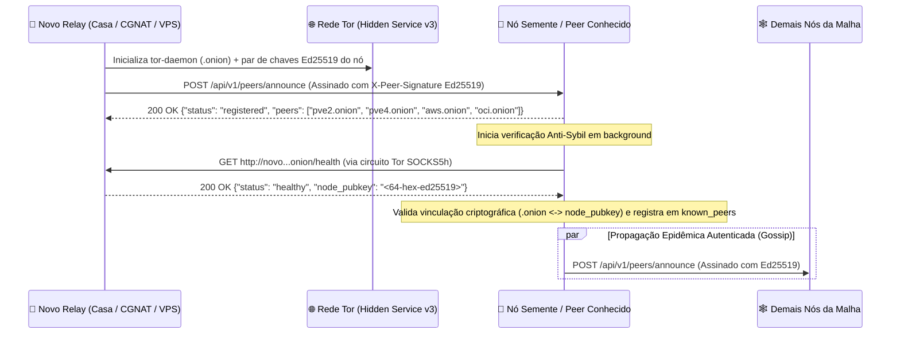
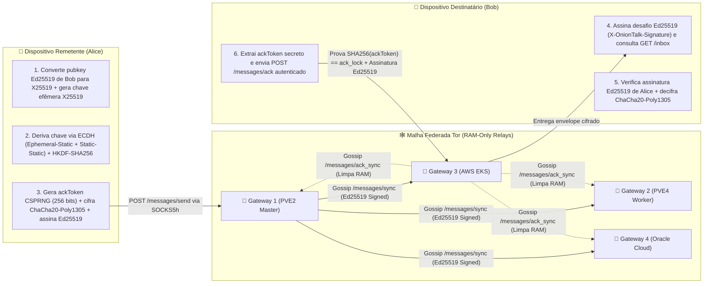

# 🧅 MANIFESTO ONIONTALK
**Privacidade Absoluta, Malha Federada Zero-Trust e Resistência Incondicional à Censura**

> *"A privacidade é necessária para uma sociedade aberta na era eletrônica. Privacidade não é segredo. Um assunto privado é algo que alguém não quer que o mundo inteiro saiba, mas um assunto secreto é algo que ninguém deve saber. A privacidade é o poder de se revelar seletivamente ao mundo."*
> — **Eric Hughes**, *A Cypherpunk's Manifesto (1993)*

---

## 1. Por Que o OnionTalk Existe (Tese Fundamental)

Mensageiros modernos falham no teste mais básico da soberania digital: **eles exigem que você entregue sua identidade civil (número de telefone, SIM card, e-mail, IP e metadados de rede) em troca da promessa de que seus servidores centrais não serão comprometidos, coagidos ou bloqueados.**

Mesmo quando o conteúdo da mensagem é criptografado ponta a ponta, a infraestrutura tradicional permanece centralizada:
1. **Identidade Vinculada ao Estado/Operadora**: Seu identificador é um número de telefone sujeito a SIM Swapping, intimações e rastreamento de grafo social.
2. **Ponto Único de Censura (DNS & IP)**: Basta bloquear os IPs ou domínios DNS de um provedor central (ou remover o aplicativo de um barramento de Push como Google FCM) para silenciar milhões de pessoas.
3. **Servidores Confiáveis por Premissa**: O roteamento centralizado sabe *quem* falou com *quem*, *quando*, *com que frequência* e *a partir de qual endereço IP*.

O **OnionTalk (`org.oniontalk.messenger`)** foi construído para erradicar essas três vulnerabilidades na raiz. Ele substitui a confiança institucional por **provas criptográficas assimétricas, memória volátil em RAM e roteamento oculto em malha sobre a rede Tor**.

---

## 2. Os 5 Mandamentos Arquiteturais do OnionTalk

1. **Zero PII (Identidade Criptográfica de 256 bits)**: Nenhuma conta exige telefone, e-mail, SMS ou cadastro central. Sua identidade é uma chave pública **Ed25519 de 256 bits (64 caracteres hexadecimais)** no formato `@<64_hex_ed25519_pubkey>:<dominio>.onion`, mapeada birracionalmente para **X25519** (`RFC 7748 / RFC 8032`).
2. **Zero-Trust nos Relays**: Qualquer pessoa pode operar um servidor Relay do OnionTalk. Por isso, o protocolo trata **todos os servidores como potencialmente hostis**. Um relay não consegue ler mensagens, não consegue forjar comandos de controle, exige assinatura **Ed25519** do destinatário para consultar o `/inbox` e exige prova criptográfica de pré-imagem (*ACK Preimage Lock*) para apagar mensagens.
3. **Zero Disco nos Servidores (RAM-Only Store-and-Forward)**: Relays nunca gravam mensagens em banco de dados ou disco (`ram-volatile-ephemeral-ttl24h`). As filas existem exclusivamente na memória RAM volátil com expiração automática (TTL de 24h) e são destruídas instantaneamente no momento do `ACK`.
4. **Zero Clearnet / Zero Vazamento de DNS**: Todo o transporte ocorre via **Tor Hidden Services v3 (`.onion` de 56 caracteres Ed25519)** usando handshake `SOCKS5h` (`ATYP=0x03`), onde a resolução do endereço ocorre dentro do circuito Tor sem jamais consultar o DNS da operadora, e a porta local do container é restrita a `127.0.0.1`.
5. **Negabilidade Plausível e Autodestruição Forense**: Se o dispositivo físico for apreendido sob coerção, o cofre **SQLCipher (AES-256-CBC + Argon2id)** conta com trituração física DoD 2-pass (*Duress Wipe*) após tentativas inválidas de senha, proteção de tela (`FLAG_SECURE`) e comando de queima sincronizada ponta a ponta (*Burn Chat*).

---

## 3. Como Funciona o Service Discovery (Descoberta Autônoma & Handshake Ed25519 Anti-Sybil)

Em uma rede verdadeiramente descentralizada e anônima, novos servidores não podem depender de um servidor DNS central nem de registros públicos de IP para serem encontrados. O OnionTalk implementa um protocolo de **Service Discovery Epidêmico Autenticado (Auto-Gossip PEX)** sobre a própria rede Tor:



### Detalhes do Mecanismo de Descoberta ([`relay.py`](https://github.com/onion-talk/oniontalk-relay/blob/main/relay.py)):
* **Auto-Identificação Criptográfica**: Ao subir com `docker compose up -d`, o container `tor-daemon` gera seu par de chaves Ed25519 no volume `tor_keys` e publica seu descritor de serviço oculto na DHT da rede Tor. O relay carrega sua identidade `.onion` e seu par de chaves `Ed25519` (`node_pubkey`).
* **Bootstrap Multi-Semente Contínuo (`bootstrap_discovery_loop`)**: A cada **90 segundos**, o nó percorre o conjunto `BOOTSTRAP_SEEDS ∪ known_peers` e anuncia sua presença em `POST /api/v1/peers/announce` assinado com `X-Peer-Signature` (`ONIONTALK_PEER_V2`).
* **Handshake Ativo Anti-Sybil (`verify_and_register_peer`)**:
  1. O relay receptor valida estritamente a gramática criptográfica do endereço v3 (`^[a-z2-7]{56}\.onion$`), a assinatura `Ed25519` da requisição e a cota `MAX_KNOWN_PEERS = 64`.
  2. Antes de registrar ou propagar o novo nó, o relay abre um circuito Tor reverso e executa um `GET http://<candidato>.onion/health`.
  3. O candidato só entra na malha e só é difundido via [`gossip_new_peer`](https://github.com/onion-talk/oniontalk-relay/blob/main/relay.py) se responder `HTTP 200 OK` com `"status": "healthy"` e `"node_pubkey"` idêntica à chave pública que assinou o anúncio.

---

## 4. Como as Mensagens São Cifradas e Distribuídas (`__ENC_X25519_CHACHA20_V2__`)

O OnionTalk combina **Criptografia Assimétrica Autenticada com Forward Secrecy por Mensagem** e **Store-and-Forward em RAM com Replicação Gossip Anycast**:



### O Ciclo de Vida de uma Mensagem Passo a Passo:
1. **Selagem Ponta a Ponta com Acordo Duplo X25519 + Assinatura Ed25519 (`CryptoManager.sealWireEnvelope`)**:
   * O remetente extrai a chave pública `Ed25519` de 256 bits do ID do destinatário (`@<64-hex>:<dominio>.onion`) e aplica o mapa birracional de Montgomery (`RFC 7748`):
     $$u = (1 + y)(1 - y)^{-1} \pmod{2^{255} - 19}$$
   * Para cada mensagem, o remetente gera um par de chaves efêmero `X25519` ($e_{priv}, e_{pub}$) e um `ackToken` aleatório de 256 bits via `SecureRandom`, publicando apenas a fechadura $\text{ack\_lock} = \text{SHA-256}(\text{ackToken})$.
   * Calcula o segredo compartilhado combinando `ECDH(e_priv, bob_x25519_pub) || ECDH(alice_x25519_priv, bob_x25519_pub)` e deriva a chave de sessão de 256 bits via **HKDF-SHA256**.
   * Cifra `ackToken || plaintext` com **ChaCha20-Poly1305 AEAD** (nonce de 96 bits + MAC de 128 bits, vinculando `msgId|sender|recipient|ephPub` no AAD) e assina o envelope com a chave privada **Ed25519** do remetente.
2. **Replicação Gossip Autenticada entre Relays (`broadcast_message_to_peers`)**:
   * O relay valida o formato do `recipient`, do `ack_lock` (64 hex) e do `timestamp`, armazena o envelope em RAM volátil (sem evicção FIFO de mensagens não lidas) e replica via `POST /api/v1/messages/sync` assinado com a chave `Ed25519` do nó (`X-Peer-Signature`).
3. **Coleta Autenticada de Inbox (`GET /api/v1/messages/inbox`)**:
   * Para consultar sua caixa postal, o destinatário assina o desafio canônico `ONIONTALK_AUTH_V2|INBOX|<user_id>|<timestamp_ms>` com sua chave privada `Ed25519` nos cabeçalhos `X-OnionTalk-Timestamp` e `X-OnionTalk-Signature`. Nenhum terceiro ou operador consegue listar caixas postais alheias.
4. **Expurgo Autenticado Global (`ACK` + `ACK_SYNC`)**:
   * Após validar a assinatura `Ed25519` do remetente e decifrar o envelope `ChaCha20-Poly1305`, o destinatário extrai o `ackToken` secreto e envia `POST /api/v1/messages/ack` autenticado.
   * O relay verifica `SHA-256(ack_token) == ack_lock` em tempo constante (`hmac.compare_digest`), destrói a mensagem da RAM e propaga `POST /api/v1/messages/ack_sync` assinado para todos os demais nós da malha.

---

## 5. Como o OnionTalk Evita a Censura (Engenharia Anti-Bloqueio)

| Vetor de Censura / Ataque | Como Mensageiros Comuns Falham | Como o OnionTalk Neutraliza |
| :--- | :--- | :--- |
| **Bloqueio de DNS (DNS Sinkholing / Poisoning)** | Operadoras bloqueiam a resolução do domínio da API central. | **Zero DNS Local (`SOCKS5h ATYP=0x03`)**: O Android nunca resolve nomes no DNS do sistema; o hostname `.onion` trafega até o daemon Tor local, que resolve o descritor criptograficamente dentro da rede Tor. |
| **Bloqueio de IP por Firewall Estatal (BGP / DPI)** | Governos bloqueiam as faixas de IP dos servidores da empresa. | **Sem IP Exposto (Tor Rendezvous + Localhost Bind)**: Os relays escutam apenas em `127.0.0.1` e no circuito Tor de 6 saltos; nem cliente nem servidor conhecem o IP um do outro. |
| **Derrubada de Servidor Central (Takedown / DDoS)** | Se o cluster principal cair, o aplicativo inteiro para de funcionar. | **Malha Multi-Cloud & P2P ELB**: Failover automático entre múltiplos `.onion` independentes (Homelab Proxmox, AWS, Oracle Cloud, Alwaysdata Paris e nós comunitários). |
| **Ataque de Nó Malicioso (Injeção / ACK Spoofing / Inbox Snooping)** | Um servidor malicioso tenta ler envelopes, injetar comandos ou apagar mensagens. | **X25519 + ChaCha20-Poly1305 + Assinatura Ed25519 + Preimage Lock**: Chaves privadas nunca saem do aparelho; `/inbox` e `/ack` exigem assinatura `Ed25519` do dono da chave; `ACKs` exigem a pré-imagem `SHA-256(ack_token) == ack_lock`. |
| **Coerção Física e Perícia Forense no Aparelho** | Peritos extraem páginas SQLite deletadas, thumbnails EXIF ou obrigam o desbloqueio. | **Defesa Anti-Forense Completa**: Cofre SQLCipher AES-256-CBC + Argon2id, `PRAGMA secure_delete=ON` + sobrescrita de B-Tree + `VACUUM`, remoção de 100% de EXIF/GPS com *LSB jitter*, `FLAG_SECURE`, *Burn Chat* remoto assinado e *Duress Wipe* DoD 2-pass. |

---

## 6. Convocação: Fortaleça a Malha

Qualquer pessoa com Docker instalado — em um Raspberry Pi, servidor caseiro atrás de CGNAT, NAS ou VPS — pode lançar um novo nó federado do OnionTalk em menos de 60 segundos:

```bash
git clone https://github.com/onion-talk/oniontalk-relay.git
cd oniontalk-relay
docker compose up -d --build
```

Sem cadastro. Sem pedir permissão. Sem abrir portas no roteador.
**Sua chave. Seu nó. Sua palavra.**
