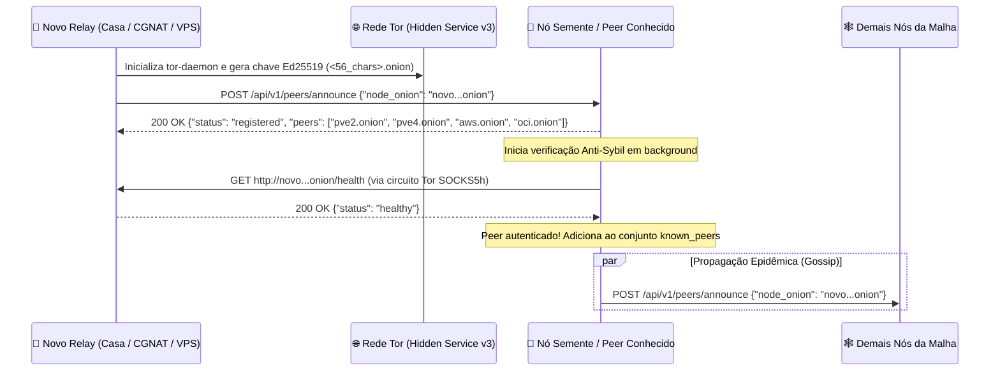
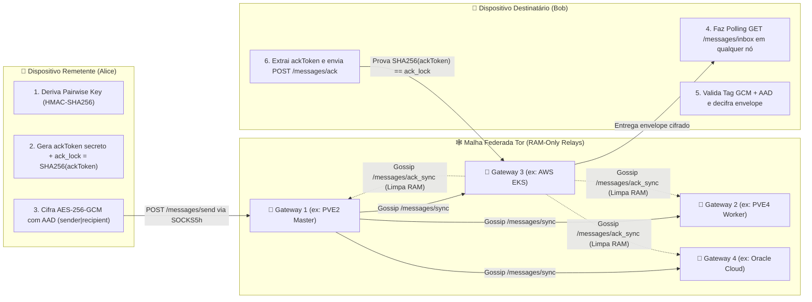

# 🧅 MANIFESTO ONIONTALK
**Privacidade Absoluta, Malha Federada Zero-Trust e Resistência Incondicional à Censura**

> *"A privacidade é necessária para uma sociedade aberta na era eletrônica. Privacidade não é segredo. Um assunto privado é algo que alguém não quer que o mundo inteiro saiba, mas um assunto secreto é algo que ninguém deve saber. A privacidade é o poder de se revelar seletivamente ao mundo."*
> — **Eric Hughes**, *A Cypherpunk's Manifesto (1993)*

---

## 1. Por Que o OnionTalk Existe (Tese Fundamental)

Mensageiros modernos falham no teste mais básico da soberania digital: **eles exigem que você entregue sua identidade civil (número de telefone, SIM card, e-mail, IP e metadados de rede) em troca da promessa de que seus servidores centrais não serão comprometidos, coagidos ou bloqueados.**

Mesmo quando o conteúdo da mensagem é criptografado ponta a ponta, a infraestrutura tradicional permanece centralizada:
1. **Identidade Vinculada ao Estado/Operadora**: Seu identificador é um número de telefone sujeito a SIM Swapping, intimações e rastreamento de grafo social.
2. **Ponto Único de Censura (DNS & IP)**: Basta bloquear os IPs ou domínios DNS de um provedor central (ou remover o aplicativo de um barramento de Push como Google FCM) para silenciar milhões de pessoas.
3. **Servidores Confiáveis por Premissa**: O roteamento centralizado sabe *quem* falou com *quem*, *quando*, *com que frequência* e *a partir de qual endereço IP*.

O **OnionTalk (`org.oniontalk.messenger`)** foi construído para erradicar essas três vulnerabilidades na raiz. Ele substitui a confiança institucional por **provas criptográficas, memória volátil e roteamento oculto em malha sobre a rede Tor**.

---

## 2. Os 5 Mandamentos Arquiteturais do OnionTalk

1. **Zero PII (Identidade Puramente Matemática)**: Nenhuma conta exige telefone, e-mail, SMS ou cadastro central. Sua identidade é derivada localmente de chaves criptográficas no formato `@<hash_sha256>:<dominio>.onion`.
2. **Zero-Trust nos Relays**: Qualquer pessoa pode operar um servidor Relay do OnionTalk. Por isso, o protocolo trata **todos os servidores como potencialmente hostis**. Um relay não consegue ler mensagens, não consegue forjar comandos de controle e não consegue sequer apagar mensagens da fila sem apresentar uma prova criptográfica de pré-imagem (*ACK Preimage Lock*).
3. **Zero Disco nos Servidores (RAM-Only Store-and-Forward)**: Relays nunca gravam mensagens em banco de dados ou disco. As filas existem exclusivamente na memória RAM volátil com expiração automática (TTL de 24h) e são destruídas instantaneamente no momento do `ACK`.
4. **Zero Clearnet / Zero Vazamento de DNS**: Todo o transporte ocorre via **Tor Hidden Services v3 (`.onion` de 56 caracteres Ed25519)** usando handshake `SOCKS5h` (`ATYP=0x03`), onde a resolução do endereço ocorre dentro do circuito Tor sem jamais consultar o DNS da operadora.
5. **Negabilidade Plausível e Autodestruição Forense**: Se o dispositivo físico for apreendido sob coerção, o cofre **SQLCipher (AES-256-CBC)** conta com trituração física DoD 2-pass (*Duress Wipe*) após tentativas inválidas de senha, proteção de tela (`FLAG_SECURE`) e comando de queima sincronizada ponta a ponta (*Burn Chat*).

---

## 3. Como Funciona o Service Discovery (Descoberta Autônoma & Anti-Sybil)

Em uma rede verdadeiramente descentralizada e anônima, novos servidores não podem depender de um servidor DNS central nem de registros públicos de IP para serem encontrados. O OnionTalk implementa um protocolo de **Service Discovery Epidêmico (Auto-Gossip PEX)** sobre a própria rede Tor:



### Detalhes do Mecanismo de Descoberta (`server/relay.py`):
* **Auto-Identificação Criptográfica**: Ao subir com `docker compose up -d`, o container `tor-daemon` gera seu par de chaves Ed25519 no volume `tor_keys` e publica seu descritor de serviço oculto na DHT (Distributed Hash Table) da rede Tor. O relay lê seu endereço em `/var/lib/tor/hidden_service/hostname`.
* **Bootstrap Multi-Semente Contínuo (`bootstrap_discovery_loop`)**: A cada **90 segundos**, o nó percorre o conjunto `BOOTSTRAP_SEEDS ∪ known_peers` (incluindo os nós em Proxmox PVE2, PVE4, AWS EKS e Oracle Cloud) e anuncia sua presença em `POST /api/v1/peers/announce`. Em resposta, recebe a lista atualizada de todos os peers ativos (**Peer Exchange — PEX**).
* **Handshake Ativo Anti-Sybil (`verify_and_register_peer`)**: Para impedir que um atacante inunde a malha com milhares de endereços `.onion` falsos ou inexistentes (*Sybil / Routing Table Poisoning*):
  1. O relay receptor valida estritamente a gramática criptográfica do endereço v3 (`^[a-z2-7]{56}\.onion$`) e respeita a cota `MAX_KNOWN_PEERS = 64`.
  2. Antes de registrar ou propagar o novo nó, o relay abre um circuito Tor reverso e executa um `GET http://<candidato>.onion/health`.
  3. O candidato só entra na malha e só é difundido via [`gossip_new_peer`](file:///C:/Users/erikt/AndroidStudioProjects/TonyLoco/server/relay.py#L368-L382) se responder `HTTP 200 OK` com `"status": "healthy"`.

---

## 4. Como as Mensagens São Distribuídas (Gossip Multicast & ACK Preimage Lock)

O OnionTalk resolve o dilema clássico das redes P2P móveis (onde o destinatário pode estar offline ou trocando de antena 4G/Wi-Fi quando o remetente envia a mensagem) combinando **Store-and-Forward em RAM** com **Replicação Gossip Anycast**:



### O Ciclo de Vida de uma Mensagem Passo a Passo:
1. **Selagem Ponta a Ponta com Prova de Pré-Imagem (`CryptoManager.sealWireEnvelope`)**:
   * O celular do remetente gera um `messageId` (UUIDv4) e deriva um segredo único de confirmação:
     $$\text{ackToken} = \text{HMAC-SHA256}(\text{pairKey}, \text{"ACK\_PREIMAGE"} \parallel \text{msgId} \parallel \text{sender} \parallel \text{recipient})$$
   * O cliente calcula a fechadura pública $\text{ack\_lock} = \text{SHA-256}(\text{ackToken})$.
   * O `ackToken` secreto é concatenado ao texto plano (`ackToken|plaintext`) e cifrado com **AES-256-GCM** (IV de 96 bits + Tag de 128 bits), vinculando `sender|recipient` como **Additional Authenticated Data (AAD)**.
2. **Despacho com Failover e Outbox Resiliente (`FederatedApiClient.sendMessage`)**:
   * O envelope `__ENC_GCM_V1__:<iv>:<ciphertext>` é enviado via `POST /api/v1/messages/send` para o primeiro gateway disponível do pool. Caso o usuário esteja sem sinal ou o circuito Tor esteja reconectando, a mensagem aguarda na `pendingOutbox` e é retransmitida automaticamente.
3. **Replicação Gossip Multicast em Memória (`broadcast_message_to_peers`)**:
   * O nó que recebe o `POST /api/v1/messages/send` guarda o objeto em sua tabela hash em RAM (`inbox[recipient]`) e dispara threads assíncronas enviando `POST /api/v1/messages/sync` para todos os demais nós da malha.
   * Todos os nós passam a reter aquela mensagem em RAM (deduplicada por `id`).
4. **Coleta Anycast Independente de Nó (`pollIncomingMessages`)**:
   * A cada **3,5 segundos**, o `backgroundScope` (`Dispatchers.IO`) do destinatário consulta `GET /api/v1/messages/inbox?user=@hash:dominio.onion` em **qualquer nó acessível** do seu pool de failover. Não importa em qual servidor o remetente depositou a mensagem: devido ao Gossip Sync, ela estará disponível em todos os nós da malha.
5. **Expurgo Autenticado Global (`ACK` + `ACK_SYNC`)**:
   * Ao abrir o envelope GCM, o destinatário recupera o `ackToken` secreto e envia `POST /api/v1/messages/ack` com `{user, messageId, ack_token}`.
   * O relay executa `verify_ack_proof`: calcula `SHA-256(ack_token)` e compara com `ack_lock`.
   * Se (e somente se) a prova matemática bater, a mensagem é apagada da RAM do relay e um broadcast `POST /api/v1/messages/ack_sync` (contendo o mesmo `ack_token`) varre e destrói a mensagem na memória de todos os outros nós da federação.

---

## 5. Como o OnionTalk Evita a Censura (Engenharia Anti-Bloqueio)

A resistência à censura do OnionTalk opera simultaneamente nas camadas de **Rede, Protocolo, Infraestrutura e Dispositivo**:

| Vetor de Censura / Ataque | Como Mensageiros Comuns Falham | Como o OnionTalk Neutraliza |
| :--- | :--- | :--- |
| **Bloqueio de DNS (DNS Sinkholing / Poisoning)** | Operadoras bloqueiam a resolução do domínio da API central. | **Zero DNS Local (`SOCKS5h ATYP=0x03`)**: O Android nunca resolve nomes no DNS do sistema; o hostname `.onion` trafega em bytes ASCII até o daemon Tor local, que resolve o descritor criptograficamente dentro da rede Tor. |
| **Bloqueio de IP por Firewall Estatal (BGP / DPI)** | Governos bloqueiam as faixas de IP dos servidores da empresa. | **Sem IP Exposto (Tor Rendezvous)**: Os relays não aceitam conexões de entrada da Internet pública; eles operam atrás de circuitos Tor de 6 saltos onde nem cliente nem servidor conhecem o IP um do outro. |
| **Derrubada de Servidor Central (Takedown / DDoS)** | Se o cluster principal cair, o aplicativo inteiro para de funcionar. | **Malha Multi-Cloud & P2P ELB**: O cliente possui failover automático (`GATEWAY_FAILOVER_POOL`) entre múltiplos `.onion` independentes (Homelab Proxmox, AWS, Oracle Cloud e nós comunitários). Se um nó cair, o app chaveia em `< 1s`. |
| **Bloqueio por CGNAT Residencial** | Usuários domésticos não conseguem hospedar nós porque operadoras bloqueiam portas de entrada. | **100% NAT/CGNAT Bypass**: Como o Tor Hidden Service abre apenas conexões *outbound* (de saída) para os *Introduction Points* da rede Tor, qualquer pessoa atrás de CGNAT ou firewall restritivo sobe um relay com `docker compose up -d`. |
| **Censura via Google / Apple Push (FCM / APNs)** | Se o Google/Apple suspender o token FCM ou bloquear notificações push, o app fica mudo em background. | **Push Local Tor Zero-Knowledge**: Zero dependência de Google Play Services. O `RepositoryImpl` mantém polling leve direto sobre o socket Tor e dispara notificações locais nativas (mesmo com o cofre SQLCipher bloqueado). |
| **Ataque de Nó Malicioso (Injeção / ACK Spoofing)** | Um servidor federado malicioso injeta comandos ou apaga a caixa postal de usuários. | **Envelope GCM + AAD + Preimage Lock**: Comandos de controle (`__CTRL_BURN_V1__`, `__CTRL_AVATAR_V1__`) sem tag GCM válida são rejeitados no cliente, e `ACKs` sem a pré-imagem `SHA-256(ack_token) == ack_lock` são bloqueados no relay. |
| **Coerção Física e Perícia Forense no Aparelho** | Peritos extraem páginas SQLite deletadas, thumbnails EXIF ou obrigam o desbloqueio. | **Defesa Anti-Forense Completa**: Cofre SQLCipher AES-256-CBC, `PRAGMA secure_delete=ON` + sobrescrita de B-Tree + `VACUUM`, remoção de 100% de EXIF/GPS com *LSB jitter*, `FLAG_SECURE`, *Burn Chat* remoto e *Duress Wipe* (trituração física DoD 2-pass na 5ª tentativa de senha). |

---

## 6. Convocação: Fortaleça a Malha

Uma rede descentralizada é tão forte quanto o número de nós independentes que a sustentam. Qualquer pessoa com Docker instalado — em um Raspberry Pi, servidor caseiro, NAS ou VPS gratuita — pode lançar um novo nó federado do OnionTalk em menos de 60 segundos:

```bash
cd server/
docker compose up -d --build
```

Sem cadastro. Sem pedir permissão. Sem abrir portas no roteador.
**Sua chave. Seu nó. Sua palavra.**

